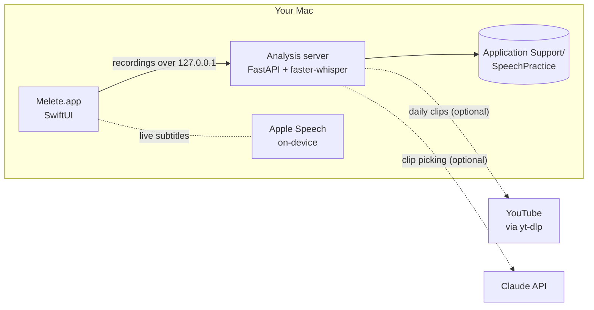

<div align="center">


# Melete

**A daily speaking studio for your Mac.**<br>
Shadow great speakers, talk through your own topics, and get one clear note on what to fix next.<br>
Recordings, transcripts and stats never leave your Mac.

[**Download for macOS**](https://github.com/oliverxuzy-ai/Melete/releases/latest/download/Melete.dmg) · [Features](#features) · [How it works](#how-it-works) · [Design](docs/DESIGN.md) · [简体中文](README.zh-CN.md)

[](https://github.com/oliverxuzy-ai/Melete/releases/latest)
[](https://github.com/oliverxuzy-ai/Melete/releases)
[](https://github.com/oliverxuzy-ai/Melete/actions/workflows/release.yml)


</div>

> *Μελέτη* is Greek for "practice". Melete was also the oldest of the three original Muses: Melete for practice, Mneme for memory, Aoide for voice. Those are the three things this app is for: practice every day, remember the key points, and train your voice.

## Why Melete

Most speaking feedback is the same few lines: slow down, speak up, fewer "um"s, vary your tone. Knowing that is easy. Practicing it every day is the hard part, and every bit of friction is a reason to skip a day.

So Melete opens on today's next exercise. Press <kbd>Return</kbd>, a water clock fills for three seconds, and you're recording. When you stop, Whisper transcribes on your Mac and you get one sentence on the most important thing to change, measured against your own recent baseline rather than a generic norm.

## Features

### One window, three places

- **Overview.** This week's laurel in the middle. On the left, how you're trending (pace, filler words, pitch range, key-point coverage). On the right, your rhythm (minutes per day, streak, the next talk on your agenda).
- **Shadow.** Listen to how a real speaker says it, then speak along or retell it in your own words. Tap any line of the transcript to start from there. With speakers, the original stays quiet while you record and the subtitles follow *your* voice, using on-device recognition with about 0.3 s of lag. With headphones, the original plays in your ears and the subtitles follow it.
- **Topic.** Speak to a prompt, a script, or a meeting you're preparing for.

### Feedback that tells you one thing

- **Local transcription** with [faster-whisper](https://github.com/SYSTRAN/faster-whisper), in English or Mandarin.
- **A critique card** after every take: a one-line verdict, up to four numbers this training block cares about, and at most three things to try next time. The full analysis is one click away.
- **Your own targets.** Pace targets start from your recent median and rise each week of a pace block. Loudness is compared only with your last five takes, because decibels depend on the mic and the distance.
- **Retelling is scored by meaning**, not word for word: each key point is marked covered, partly covered, or missed.

### A plan, so you never have to pick

- **A nine-week training cycle**, like a running plan: Τάχος pace and volume (2 weeks), Τόνος intonation and pauses (2), Μῦθος storytelling (2), Πρόσωπον speaking to different audiences (2), Ἀνάπαυσις taper (1). You can pin one block in Settings.
- **Daily clips.** Every morning Melete cuts one or two 90-second clips from talks and lectures: a story to shadow and an argument to retell. Paste any YouTube link (add `&t=` to start there) to make your own.
- **Impromptu prompts** in the forms of the ancient Greek rhetoric schools (narrative, chreia, description, comparison, thesis, rebuttal and more), about things you actually talk about at work.
- **Agenda.** Add an upcoming talk (an architecture review, a 1:1, an interview) and Melete counts back six prep steps, like a taper before a race.
- **Weekly review**, Mac notifications, and optional reminders on your phone through [ntfy.sh](https://ntfy.sh).

### Always one keystroke away

- <kbd>⌃</kbd><kbd>⌥</kbd><kbd>R</kbd> from any app starts today's next item.
- The laurel in the menu bar shows today's plan.
- The analysis server starts in the background. You can record before it is ready; the audio waits and is analyzed as soon as it is.

### Private by design

Audio, transcripts and statistics are stored only in `~/Library/Application Support/SpeechPractice/`. Your recordings are never uploaded. Melete goes online only to download the speech models once, to fetch daily clip audio with yt-dlp, and, if you turn them on, to send phone reminders through ntfy or ask Claude to pick a clip.

## Install

1. Download [**Melete.dmg**](https://github.com/oliverxuzy-ai/Melete/releases/latest/download/Melete.dmg) from the [latest release](https://github.com/oliverxuzy-ai/Melete/releases/latest), open it, and drag Melete into Applications.
2. Melete is not notarized yet, so the first time you open it macOS says it cannot verify the developer. Open **System Settings → Privacy & Security** and click **Open Anyway**, or run:

   ```sh
   xattr -dr com.apple.quarantine /Applications/Melete.app
   ```

3. For daily clips, install yt-dlp and FFmpeg:

   ```sh
   brew install yt-dlp ffmpeg
   ```

| Requirement | |
|---|---|
| macOS | 26 Tahoe or later |
| Chip | Apple Silicon |
| Disk | About 500 MB for the English model, downloaded on first launch. The Mandarin model (about 1.6 GB) loads the first time you record in Mandarin. |
| Permissions | Microphone, and Speech Recognition for live subtitles |
| Interface | Simplified Chinese (English is in progress) |

## Quick start

1. Melete opens on **Overview**. Press <kbd>Return</kbd> to jump to today's next item. The water clock fills for three seconds, then recording starts.
2. Press <kbd>Space</kbd> to stop. The critique card appears, and **Next** takes you to the next item. Not happy halfway through? Press <kbd>Esc</kbd> and the take is neither saved nor analyzed.
3. Finishing any one item counts as practicing today.

| Shortcut | Action |
|---|---|
| <kbd>Return</kbd> | Start today's next item |
| <kbd>Space</kbd> | Stop recording |
| <kbd>Esc</kbd> | Discard the take, or close a panel |
| <kbd>⌘</kbd><kbd>R</kbd> | Start or stop recording |
| <kbd>⌘</kbd><kbd>1</kbd> to <kbd>⌘</kbd><kbd>3</kbd> | Overview, Shadow, Topic |
| <kbd>⌘</kbd><kbd>4</kbd> | All recordings |
| <kbd>⌘</kbd><kbd>N</kbd> | New script |
| <kbd>⌘</kbd><kbd>,</kbd> | Settings |
| <kbd>⌃</kbd><kbd>⌥</kbd><kbd>R</kbd> | Start today's next item from any app |

### Optional: Claude

Add an Anthropic API key in **Settings → Claude**. Once a day, Claude picks the best clip from the candidates the local rules found, and writes a title plus two notes on where the speaker pauses and what they stress. The default model is Claude Opus 5.5; you can switch to Sonnet 5.5 or Haiku 5.5. Without a key, or if a request fails, Melete falls back to the local rules. The key is stored only in `settings.json` on your Mac, readable only by you.

## How it works



The native app bundles a Python analysis server, so there is nothing else to install or run.

**Models.** English uses Whisper `small` (about 500 MB; a 60-second take is ready in about 8 seconds) and is warmed up at launch. Mandarin uses `large-v3-turbo` (about 1.6 GB), loaded only when you first record in Mandarin. They are split on purpose: `small` drops sentences and mixes in traditional characters on Mandarin, while `turbo` swallows English fillers like "like" and "um" that `small` keeps.

<details>
<summary><b>What each metric means</b></summary>

| Metric | Meaning |
|---|---|
| Pace | Words per minute over the whole take. The target band comes from your own baseline and rises each week of a pace block. |
| Pace without pauses | Words per minute of actual speaking time |
| Pause | A gap of 0.5 seconds or more between two words |
| Filler words | um, uh, like, you know, I mean, basically… |
| Hedges | maybe, I think, just, kind of… |
| Loudness | Compared only with your last five takes, because absolute decibels depend on the mic and distance |
| Pitch range | Rough range of the fundamental frequency, in semitones. A small range can sound monotone. |
| Key-point coverage | The source is split into key points by sentence, and each is judged covered, partly covered, or missed by meaning |

The metrics are heuristics for tracking yourself, not professional measurements. The filler and hedge word lists live at the top of `analysis.py`, and are mirrored in `native/Sources/SpeechPractice/SessionDetailView.swift` and `static/index.html`; change them together.

</details>

## Build from source

You need Xcode 26 and [uv](https://docs.astral.sh/uv/).

```sh
git clone https://github.com/oliverxuzy-ai/Melete.git
cd Melete
./build_native.sh            # builds dist/Melete.app
./build_native.sh --install  # also copies it to /Applications (quit the app first)
```

`--install` replaces an older `SpeechPractice.app`. The bundle ID is unchanged, so history, exercises and settings carry over.

<details>
<summary><b>Development mode and debug flags</b></summary>

Run the analysis server on its own:

```sh
./run.sh            # or .venv/bin/python server.py
```

Flags for `dist/Melete.app/Contents/MacOS/SpeechPractice`:

- `SPEECH_SERVER_URL=http://127.0.0.1:8765` connects to the dev server instead of starting the bundled one.
- `--space home|shadow|topic` opens a place directly; `--tray settings|history|clips|agenda|newTopic|newEvent|addLink` opens a panel.
- `--selftest` decodes every endpoint against `SPEECH_SERVER_URL`, then exits.
- `--render <dir>` renders every place to light and dark PNGs offscreen, then exits (`RENDER_ONLY=home,settings` renders a subset). Launch it with `open`, because SwiftUI does not open the main window when the binary is run directly:
  `open -n --env SPEECH_SERVER_URL=http://127.0.0.1:8765 dist/Melete.app --args --render /tmp/render`
- `--e2e <report>` runs the end-to-end test: `MELETE_FAKE_MIC=<wav>` stands in for the microphone and goes through the real upload, transcription and critique, writing PASS or FAIL per check, including frame intervals while recording. `--perf <report>` measures only the frame rate while speaking. Point both at a server that uses a copy of your data.

Server environment variables:

- `SPEECH_DATA_DIR` uses another data directory (a copy, for tests).
- `SPEECH_NO_DAILY=1` turns off the daily clip job; `DAILY_START_DELAY` sets how many seconds it waits after launch (default 120).
- `WHISPER_MODEL=medium` and `WHISPER_MODEL_ZH=medium` change the English and Mandarin models.

Test the clip pipeline offline:

```sh
.venv/bin/python daily.py --local audio-file "Title" "Speaker" story
```

</details>

<details>
<summary><b>Project layout</b></summary>

| Path | What it is |
|---|---|
| `native/` | The SwiftUI app. `Theme.swift` holds the design tokens; `Components.swift` the water clock, laurel and pace gauge; `RootView.swift` the window and top navigation; `HomeView.swift` the Overview; `StudioView.swift` the Shadow and Topic studios; `Stage.swift` the stage and critique card; `Trays.swift` the panels; `SettingsPanel.swift` Settings; `SystemIntegration.swift` notifications, the global hotkey, launch at login and the menu bar; `E2E*.swift` the end-to-end tests. |
| `server.py` | FastAPI server |
| `coach.py` | Training cycle, targets, prompts, daily plan, agenda, critique, weekly review |
| `daily.py` | Daily clip pipeline and background job |
| `analysis.py` | Transcription and metrics. `coverage.py` scores key points; `shadow.py` aligns shadowing subtitles. |
| `build_assets/` | The app icon in Icon Composer format, generated by `make_icon.swift` and compiled by `make_icon.sh` |
| `static/`, `app.py`, `build_app.sh` | The old web version, no longer maintained |

</details>

### Releases

Every push to `main` builds Melete on GitHub Actions and publishes a release with `Melete.dmg`, `Melete.zip` and their checksums. Pull requests get the same build as a downloadable workflow artifact. Version numbers follow the commit messages since the last release:

| Commit message | Bump | Example |
|---|---|---|
| anything | patch | 2.0.0 → 2.0.1 |
| starts with `feat:`, or contains `#minor` | minor | 2.0.1 → 2.1.0 |
| contains `BREAKING CHANGE` or `!:`, or `#major` | major | 2.1.0 → 3.0.0 |

To jump to a specific version, raise `CFBundleShortVersionString` in `native/Resources/Info.plist`. You can also release by hand from **Actions → Build & Release → Run workflow** and choose the bump. Changes that only touch Markdown or `docs/` don't trigger a release.

## Design

Ancient marble was never white. Greek temples and statues were painted, with pigment only where it mattered: Egyptian blue behind a relief, cinnabar in the folds of a robe, gold on a laurel. Melete works the same way. The ground is quiet marble and paper, and each pigment does exactly one job.


The colors, type, materials, motion and the reasoning behind each decision are in [docs/DESIGN.md](docs/DESIGN.md).

## Acknowledgments

- [faster-whisper](https://github.com/SYSTRAN/faster-whisper) and [CTranslate2](https://github.com/OpenNMT/CTranslate2), running OpenAI's [Whisper](https://github.com/openai/whisper) models
- [FastAPI](https://fastapi.tiangolo.com) and [Uvicorn](https://www.uvicorn.org)
- [yt-dlp](https://github.com/yt-dlp/yt-dlp) and [FFmpeg](https://ffmpeg.org)
- [ntfy](https://ntfy.sh) for phone reminders
- Design references: Dia by The Browser Company, bencho.dev, 60fps.design, and Benji Taylor's Family
