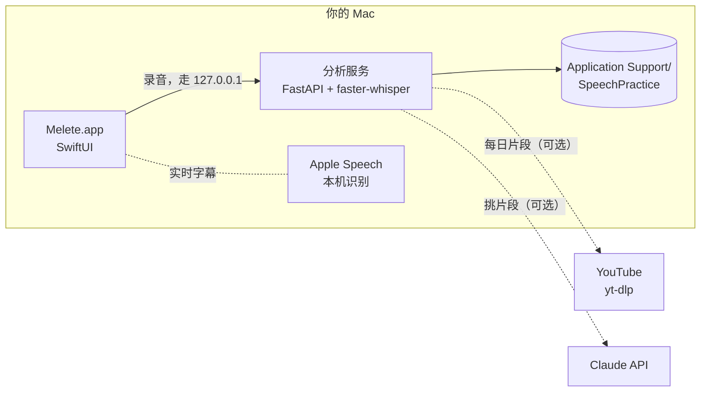

<div align="center">



# Melete

**每天练口语的 Mac App。**<br>
先听别人怎么讲再跟着讲，或者围绕自己的题目讲，讲完只告诉你下次最该改的那一件事。<br>
录音、转写和数据都只在你的 Mac 上。

[**下载 macOS 版**](https://github.com/oliverxuzy-ai/Melete/releases/latest/download/Melete.dmg) · [功能](#功能) · [工作原理](#工作原理) · [设计](docs/DESIGN.md) · [English](README.md)

[](https://github.com/oliverxuzy-ai/Melete/releases/latest)
[](https://github.com/oliverxuzy-ai/Melete/releases)
[](https://github.com/oliverxuzy-ai/Melete/actions/workflows/release.yml)


</div>

> Melete（Μελέτη）是希腊语的“练习”，也是最早的三位缪斯之一：Melete 管练习，Mneme 管记忆，Aoide 管声音。这三样正好是这个 App 管的事：每天练，记住要点，把声音练出来。

## 为什么做 Melete

关于讲话的反馈翻来覆去就那几句：说慢一点，大声一点，少点“嗯”，语调别那么平。道理都懂，难的是每天真的去练，而每多一步摩擦，就多一个今天不练的理由。

所以 Melete 一打开就停在今天的下一项。按回车，水钟注满三秒，自动开始录。讲完后本机的 Whisper 转写，只给你一句最该改的点评，标准是你自己最近的录音，不是通用的“英语汇报 130 到 160 词每分钟”。

## 功能

### 一个窗口，三个地方

- **总览**：本周的桂冠居中，左边是自己讲的表现走势（语速、填充词、音高起伏、要点覆盖），右边是节奏（这周每天几分钟、连续天数、下一场要讲的会）。
- **跟读**：先听别人怎么讲，再跟着讲，或者听完用自己的话复述。点原文的任意一句，就从那一句开始听。用扬声器外放时，录音期间原声不放，字幕跟着你的声音走（本机实时识别，约 0.3 秒）；戴耳机时原声在耳机里同步播放，字幕跟原声。
- **主题**：围绕一个题目、讲稿或要讲的会，自己讲。

### 点评只说一件事

- **本机转写**：用 [faster-whisper](https://github.com/SYSTRAN/faster-whisper)，支持英文和普通话。
- **点评卡**：每次讲完出现一句结论，最多四个这个训练块关心的数字，最多三条下次怎么改。完整分析收在“看完整分析”里。
- **目标随你走**：语速目标从你最近的中位数往上加，语速块里每周再加一点。音量只和你最近五次录音比，因为分贝的绝对值取决于麦克风和距离。
- **复述按意思算**：原文拆成要点，逐条判断讲到、部分讲到、没讲，不按逐字。

### 不用自己挑练什么

- **九周训练周期**，像跑步训练一样分块：Τάχος 语速与音量两周，Τόνος 语调与停顿两周，Μῦθος 讲故事两周，Πρόσωπον 看对象换说法两周，Ἀνάπαυσις 减量一周。可以在设置里固定在某一块。
- **每日片段**：每天清晨从演讲和讲座里挑一到两段九十秒左右的片段，讲故事的用来跟读，讲道理的用来复述。也可以贴 YouTube 链接（带 `&t=` 就从那里截），马上做成片段。
- **即兴题库**：按古希腊修辞学校的练习形式（叙事、引申、描述、比较、立论、换对象、致谢、反驳、答问、汇报）出题，内容是你工作里真会讲的话题。
- **议程**：把要讲的场合加进来（架构评审、1:1、面试），从那天往前倒排六步备讲，像比赛前的减量。
- **周小结**、Mac 通知，以及可选的手机提醒（[ntfy.sh](https://ntfy.sh)，免费）。

### 随时一键开始

- 在任何应用里按 <kbd>⌃</kbd><kbd>⌥</kbd><kbd>R</kbd>，直接开始今天的下一项。
- 菜单栏的桂冠图标：看今天的计划，一键开始。
- 分析服务在后台启动，不挡窗口。服务还没好时也可以录，录完的音频先存起来，服务好了自动分析。

### 隐私

录音、转写和统计只存在 `~/Library/Application Support/SpeechPractice/`，录音从不上传。Melete 只在这几种情况下联网：第一次下载语音模型；用 yt-dlp 下载每日片段的音频；以及你打开了的话，通过 ntfy 推送手机提醒、请 Claude 挑片段。

## 安装

1. 从[最新版本](https://github.com/oliverxuzy-ai/Melete/releases/latest)下载 [**Melete.dmg**](https://github.com/oliverxuzy-ai/Melete/releases/latest/download/Melete.dmg)，打开后把 Melete 拖进“应用程序”。
2. Melete 还没有经过苹果公证，第一次打开时 macOS 会提示无法验证开发者。打开 **系统设置 → 隐私与安全性**，点 **仍要打开**，或者在终端运行：

   ```sh
   xattr -dr com.apple.quarantine /Applications/Melete.app
   ```

3. 每日片段需要 yt-dlp 和 ffmpeg：

   ```sh
   brew install yt-dlp ffmpeg
   ```

| 要求 | |
|---|---|
| 系统 | macOS 26 Tahoe 或更新 |
| 芯片 | Apple Silicon |
| 磁盘 | 英文模型约 500 MB，第一次启动时下载；中文模型约 1.6 GB，第一次录中文时才加载 |
| 权限 | 麦克风；实时字幕需要语音识别 |
| 界面语言 | 简体中文或英文，随时在 设置 > 语言 里切换 |

## 快速上手

1. 打开 App 停在**总览**。按回车，直接进入今天下一项所在的那一边，水钟注满三秒后自动开始录音。
2. 按空格停止。讲完出现点评卡，“下一项”直接进入下一段。讲到一半不满意，按 Esc，这一段不保存也不分析。
3. 完成任意一项就算今天练过。

| 快捷键 | 作用 |
|---|---|
| <kbd>Return</kbd> | 开始今天的下一项 |
| <kbd>Space</kbd> | 停止录音 |
| <kbd>Esc</kbd> | 放弃这段，或收起面板 |
| <kbd>⌘</kbd><kbd>R</kbd> | 开始或停止录音 |
| <kbd>⌘</kbd><kbd>1</kbd> 到 <kbd>⌘</kbd><kbd>3</kbd> | 总览、跟读、主题 |
| <kbd>⌘</kbd><kbd>4</kbd> | 全部记录 |
| <kbd>⌘</kbd><kbd>N</kbd> | 新讲稿 |
| <kbd>⌘</kbd><kbd>,</kbd> | 设置 |
| <kbd>⌃</kbd><kbd>⌥</kbd><kbd>R</kbd> | 在任何应用里开始今天的下一项 |

### 可选：Claude

在 **设置 > Claude（可选）** 填上 Anthropic API key 以后，每天一次请求，Claude 从规则挑出的候选段落里选最合适的一段，写一个中文标题和两条“注意他怎么停顿、重读哪里”。默认 Claude Opus 5.5，可以换 Sonnet 5.5 或 Haiku 5.5。不开也完全能用，请求失败时自动退回本机规则。Key 只存在本机的 `settings.json`（权限 600）。

## 工作原理



原生 App 里自带打包好的 Python 分析服务，不需要另外安装或启动。

**模型**：英文用 Whisper `small`（约 500 MB，60 秒录音约 8 秒出结果），启动时预热。中文用 `large-v3-turbo`（约 1.6 GB），第一次录中文时才加载，平时不占内存。为什么分开：small 对普通话不稳定，会掉句、混入繁体和乱码；turbo 稳定且更准。英文没有用 turbo，是因为它会把 like、um 这类填充词吞掉，而 small 会保留。

<details>
<summary><b>指标说明</b></summary>

| 指标 | 含义 |
|---|---|
| 语速 | 总词数 / 总时长。目标带由你自己的基线算出，语速块里每周上调 |
| 去掉停顿后的语速 | 词数 / 实际开口时间 |
| 停顿 | 相邻两个词之间间隔 ≥ 0.5 秒 |
| 填充词 | um / uh / like / you know / I mean / basically 等 |
| 弱化 / 犹豫用语 | maybe / I think / just / kind of 等 |
| 音量 | 只和你最近五次录音比，因为分贝的绝对值取决于麦克风和距离 |
| 音高起伏 | 粗略的基频范围（半音）。太小可能是语调单一 |
| 要点覆盖 | 原文按句拆成要点，按意思判断讲到、部分讲到、没讲 |

指标都是启发式的自我追踪数据，不是专业测量。填充词和弱化词列表在 `analysis.py` 顶部，同时镜像在 `native/Sources/SpeechPractice/SessionDetailView.swift` 和 `static/index.html`，改的时候一起改。

</details>

## 从源码构建

需要 Xcode 26 和 [uv](https://docs.astral.sh/uv/)。

```sh
git clone https://github.com/oliverxuzy-ai/Melete.git
cd Melete
./build_native.sh            # 打包 dist/Melete.app
./build_native.sh --install  # 同时装到 /Applications（先退出 App）
```

`--install` 会替换旧的 SpeechPractice.app。Bundle ID 没变，历史记录、练习和设置都会保留。

<details>
<summary><b>开发模式和调试参数</b></summary>

单独启动分析服务：

```sh
./run.sh            # 或 .venv/bin/python server.py
```

调试参数（对 `dist/Melete.app/Contents/MacOS/SpeechPractice`）：

- `SPEECH_SERVER_URL=http://127.0.0.1:8765` 连开发服务而不拉子进程。
- `--lang en|zh` 这一次用指定的界面语言启动，不改设置。`--render`、`--e2e` 等测试没给 `--lang` 时用中文。
- `--space home|shadow|topic` 直接打开某个地方，`--tray settings|history|clips|agenda|newTopic|newEvent|addLink` 直接打开某个抽屉。
- `--selftest` 对 `SPEECH_SERVER_URL` 解析所有接口然后退出。
- `--render <目录>` 用离屏渲染把各个地方画成浅色和深色的 PNG 然后退出，用来审视设计（`RENDER_ONLY=home,settings` 只画其中几张）。需要用 `open` 启动（直接执行二进制时 SwiftUI 不开主窗口）：
  `open -n --env SPEECH_SERVER_URL=http://127.0.0.1:8765 dist/Melete.app --args --render /tmp/render`
- `--e2e <报告>` 端到端测试：用 `MELETE_FAKE_MIC=<wav>` 代替麦克风，走真实的上传、转写和点评，逐项写 PASS 或 FAIL，包括录音时的帧间隔。`--perf <报告>` 只测说话时的帧率。都要指向一份数据副本的服务。

服务端的环境变量：

- `SPEECH_DATA_DIR` 换数据目录（测试时用一份副本）。
- `SPEECH_NO_DAILY=1` 关掉每日片段的后台任务，`DAILY_START_DELAY` 改后台任务启动前的等待秒数（默认 120）。
- `WHISPER_MODEL=medium` 改英文模型，`WHISPER_MODEL_ZH=medium` 改中文模型。

离线测试片段流水线：

```sh
.venv/bin/python daily.py --local 音频文件 "标题" "说话人" story
```

</details>

<details>
<summary><b>文件结构</b></summary>

| 路径 | 是什么 |
|---|---|
| `native/` | SwiftUI App。`Theme.swift` 是设计令牌，`Components.swift` 是水钟、桂冠、语速刻度等组件，`RootView.swift` 是窗口和顶部导航，`HomeView.swift` 是总览，`StudioView.swift` 是跟读和主题两个工作室，`Stage.swift` 是讲台和点评卡，`Trays.swift` 是底部抽屉，`SettingsPanel.swift` 是设置，`SystemIntegration.swift` 是通知、全局快捷键、开机启动和菜单栏，`L10n.swift` 是界面语言，`E2E*.swift` 是端到端测试 |
| `server.py` | FastAPI 服务 |
| `coach.py` | 训练周期、目标、题库、今日计划、议程、点评、周报 |
| `daily.py` | 每日片段流水线和后台任务 |
| `i18n.py` | 服务端写计划、点评和片段说明时用哪种语言，跟着 App 走 |
| `analysis.py` | 转写与指标计算。`coverage.py` 算要点覆盖，`shadow.py` 做跟读字幕对齐 |
| `build_assets/` | App 图标，Icon Composer 格式，由 `make_icon.swift` 生成、`make_icon.sh` 编译 |
| `static/`、`app.py`、`build_app.sh` | 旧的网页版，不再维护 |

</details>

### 发布

每次推送到 `main`，GitHub Actions 会自动打包 Melete，并发布一个带 `Melete.dmg`、`Melete.zip` 和校验和的 Release。Pull Request 也会打包，产物可以在那次 Actions 运行的页面下载，但不发布。版本号按上次发布以来的提交信息自动递增：

| 提交信息 | 递增 | 例子 |
|---|---|---|
| 任意 | 补丁号 | 2.0.0 → 2.0.1 |
| 以 `feat:` 开头，或包含 `#minor` | 次版本号 | 2.0.1 → 2.1.0 |
| 包含 `BREAKING CHANGE` 或 `!:`，或 `#major` | 主版本号 | 2.1.0 → 3.0.0 |

想直接跳到某个版本，就把 `native/Resources/Info.plist` 里的 `CFBundleShortVersionString` 改大。也可以在 **Actions → Build & Release → Run workflow** 手动发布并选择递增方式。只改 Markdown 或 `docs/` 的推送不会触发发布。

## 设计

大理石从来不是白的。古希腊的神庙和雕像原本是彩绘的，颜料只用在要紧的地方：浮雕的蓝底、衣褶的朱红、桂冠的金。Melete 的界面也一样：底子是安静的大理石和纸，颜色只出现在“活着”的地方，每种颜料只做一件事。


颜色、字体、材质、动效，以及每个设计决定背后的理由，见 [docs/DESIGN.md](docs/DESIGN.md)。

## 致谢

- [faster-whisper](https://github.com/SYSTRAN/faster-whisper) 和 [CTranslate2](https://github.com/OpenNMT/CTranslate2)，运行 OpenAI 的 [Whisper](https://github.com/openai/whisper) 模型
- [FastAPI](https://fastapi.tiangolo.com) 和 [Uvicorn](https://www.uvicorn.org)
- [yt-dlp](https://github.com/yt-dlp/yt-dlp) 和 [FFmpeg](https://ffmpeg.org)
- [ntfy](https://ntfy.sh)：手机提醒
- 设计参考：The Browser Company 的 Dia、bencho.dev、60fps.design、Benji Taylor 的 Family
